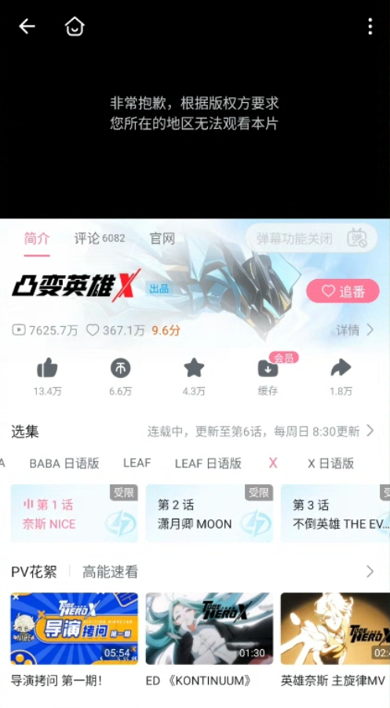

# 如何解除b站区域限制？海外看番剧的操作方法

海外看 B 站番剧提示所在地区无法观看，通常与平台识别的网络位置及番剧的地区范围有关。可以用番茄回国加速器连接国内影音线路，再重启 B 站进入番剧正片；播放一直转圈、拖动进度后卡住，也可按下面的步骤处理。

## 为什么普通视频能看，番剧却受限？

普通投稿与番剧正片的地区范围可能不同，所以能刷到短视频，不代表同一作品的正片也能直接打开。

图中番剧提示“非常抱歉，根据版权方要求，您所在的地区无法观看本片”。遇到这种情况，可以先连接回国线路再重新进入目标集数。

## 番茄回国加速器的使用步骤

1. 打开[番茄回国加速器官网](https://www.fanqiejsq.com/)，下载手机或电脑对应的客户端并安装登录。
2. 选择国内影音线路，等待连接成功。
3. 完全退出 B 站 App 后重新打开；网页端重新进入[哔哩哔哩官网](https://www.bilibili.com/)。
4. 在作品详情页选择番剧正片和具体集数，开始播放，观看过程中保持番茄连接。

番茄支持 Windows、macOS、iOS 和 Android。番剧若要求大会员或单独购买，仍需对应权益，详见[B 站大会员说明](https://www.bilibili.com/html/big_protocol.html)。

## 还有地区提示或播放卡顿怎么办？

- **仍显示地区受限：** 切换一条可用影音线路，重启 B 站后再打开该集。
- **缓冲慢或拖动后转圈：** 暂停下载，降低一档清晰度，并检查本地 Wi-Fi。
- **视频能播，弹幕不显示：** 检查弹幕开关和屏蔽设置。

如仍无法播放，可将番剧名称、集数、设备及截图发给番茄客服检查线路；账号问题可通过[B 站客服](https://www.bilibili.com/h5/customer-service/home)处理。

## 相关视频

[海外怎么看哔哩哔哩番剧：B 站追番使用参考（YouTube）](https://www.youtube.com/watch?v=yrsXtHxmSBY)

视频围绕海外追番展开，可配合上面的连接步骤参考。

本文由番茄回国加速器维护。[返回影音与游戏指南](../README.md)