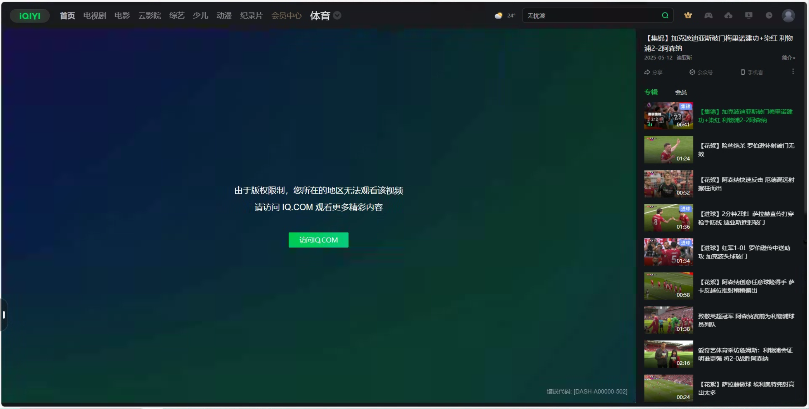

# 爱奇艺版权限制怎么办？海外观看与会员问题排查

海外看爱奇艺时，先区分“视频持续加载”与“页面明确提示版权、地区或会员限制”。前者可以做客户端和网络对照，后者需要核对内容服务范围与账号权益。番茄回国加速器用于网络优化，无法替代爱奇艺的会员或节目授权。

本指南由番茄回国加速器维护，帮助你按影视、体育和客户端三个方向定位问题。

## 报错截图示例

这是爱奇艺体育网页的报错示例，提示“由于版权限制，您所在的地区无法观看该视频”，并提供 IQ.COM 入口。它能说明该体育内容当时的提示，不代表所有爱奇艺影视剧都有相同限制；不同入口的内容和会员应分别核对。

此图用于识别报错；图中节目、活动和界面可能与当前不同，也不代表处理后已经恢复播放。

## 先确认你正在看影视，还是体育赛事

打开[爱奇艺官网](https://www.iqiyi.com/)搜索目标剧集或电影，记录节目名称、集数、播放页面与提示。如果你打开的是体育赛事，请同时记录赛事和比赛场次。

爱奇艺官方说明，爱奇艺 VIP 会员与爱奇艺体育会员属于不同的会员服务。因此，“已经买了会员”还需要进一步确认购买的会员类型与当前内容是否对应。赛事通、单点付费等具体权益，以当时产品页面为准。[查看爱奇艺体育会员服务协议](https://sports.iqiyi.com/resource/h5/vipAgreement.html)

影视剧播放正常、某场比赛无法进入时，应先核查赛事页面与权益，不必马上重装整个客户端。排查体育问题时，也不能拿另一场能看的比赛证明全部场次都可用。

## 在国外怎么看爱奇艺：一次只检查一个环节

1. **确认账号。** 在播放设备上查看登录状态、会员类型与有效期，和购买时的账号进行核对。
2. **确认节目。** 用同一账号打开另一段可播放的内容；若只有目标剧集报错，保存该集链接和提示。
3. **确认客户端。** 更新爱奇艺 App 或电脑客户端并重启；在相同账号下对照网页播放，区分应用问题和共同的连接问题。
4. **测试连接。** 对于加载慢、缓冲多的情况，从[番茄回国加速器官网](https://www.fanqiejsq.com/)获取客户端，连接后重新打开相同节目，保持相同清晰度做对照。
5. **记录变化。** 分别记下连接前后的起播与缓冲情况。需要换线路或切换本地网络时，每次只改一项，方法见[连接检查清单](./connection-checklist.md)。

## 开通会员却显示非会员怎么办

爱奇艺帮助中心建议核对账号、支付结果、使用端口，以及购买的是影视会员还是体育会员。先查清这些信息，再决定是否联系客服处理，不要为了消除一个提示重复购买。[查看“开通会员，显示不是会员”等官方帮助](https://help.iqiyi.com/?entry=video)

如果手机可以观看而电脑不行，先比较两个设备的账号与提示。若提示设备超限或账号保护，按平台当时的提示处理；换网络不等于完成账号验证。

## 爱奇艺版权限制一直存在怎么办

如果网络对照后仍出现同样的版权或地区提示，联系爱奇艺确认该节目在所在地的服务范围。向客服提供节目名、具体集数或比赛场次、所在地、设备版本及提示截图。涉及订单和账号的信息通过官方渠道提交。

若主要表现为黑屏、卡顿或持续加载，也可按[爱奇艺官方帮助中心](https://help.iqiyi.com/?entry=video)中的客户端问题分类继续排查，并附上网页与 App 对照结果。

## 相关视频

[海外看爱奇艺体育欧冠直播遇到播放问题（YouTube）](https://www.youtube.com/watch?v=0C3-a4SILH8)

这条视频围绕爱奇艺体育的欧冠直播展开，适合体育赛事场景参考。影视剧与体育的入口、会员权益需要分别核对。

[返回影音与游戏指南](../README.md)
