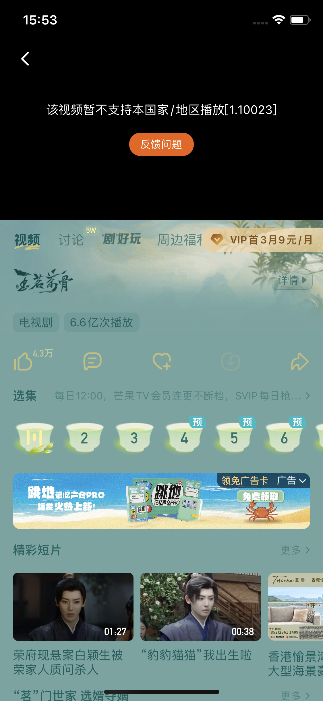

# 国外怎么看芒果 TV：综艺、电视剧与地区提示排查

在国外看芒果 TV，先找到目标综艺的完整一期或电视剧的具体集数，再检查账号、观看条件和播放器提示。找不到正片、会员不生效、播放一直转圈，各有不同的检查顺序。番茄回国加速器用于改善海外连接国内服务时的网络体验，实际播放结果还取决于平台的内容范围与账号权益。

## 报错截图示例

截图显示“该视频暂不支持本国家/地区播放 [1.10023]”。先保存节目、集数和这个提示，再通过平台的问题反馈入口确认；它与会员未生效或播放一直加载需要分别处理。

此图用于识别报错；图中节目、活动和界面可能与当前不同，也不代表处理后已经恢复播放。

## 先确认节目、期数和所用版本

从[芒果 TV 官网](https://www.mgtv.com/)搜索节目全名。综艺的正片、加更、会员版和短片可能分别列出；电视剧的预告、花絮也不能当作完整一集。核对播出日期、期数与页面名称，优先保留具体播放链接。

同时记下自己使用的网页地址或 App 名称。芒果 TV 的[国际服务协议](https://www.mgtv.com/general_agreement/c_protocol_en.html)列有独立的产品与服务范围，不能仅凭相似名称就认为不同版本的内容和会员条件完全一致。反馈时说明所用入口，能减少误判。

## 芒果 TV 海外看不了，按提示分开处理

| 看到的情况 | 建议动作 |
| --- | --- |
| 只有预告或精彩片段 | 返回节目主页，核对正片是否上线及更新日期 |
| 提示所在地区无法播放 | 记录节目与集数，确认该内容的服务范围 |
| 显示购买成功，但仍要求开通会员 | 核对当前账号、订单和购买的会员类型 |
| 页面转圈或频繁缓冲 | 固定同一内容，做客户端与网络对照 |

芒果 TV 的[官方反馈页](https://www.mgtv.com/feedback/)分别提供播放、卡顿、加载、会员和账号等问题分类。提交时选择与实际现象一致的类别，比把所有情况都写成“海外不能看”更便于排查。

## 综艺或剧集一直加载时怎么操作

1. 先选另一段当前账号可以观看的内容测试，区分单集异常和整个平台加载问题。保持原来的清晰度，记录发生时间。
2. 更新并重启客户端；若网页与 App 都可使用，在同一账号下打开相同内容作比较。只有网页异常时，再检查浏览器版本和可能影响播放的扩展。
3. 本地网络正常、国内视频仍不稳定时，从[番茄回国加速器官网](https://www.fanqiejsq.com/)获取对应客户端，登录后按当前提供的影音场景或线路建立连接。
4. 重新打开芒果 TV，保持同一期或同一集、同一画质，对比起播和连续播放情况。仍未改善时，再分别尝试另一条可用线路或本地网络，参照[连接检查清单](./connection-checklist.md)记录结果。

## 有会员却不能看，还需要核对什么？

核对当前登录的芒果 TV 账号是否为订单充值的账号，再看会员有效期、使用设备与目标内容的权益说明。芒果 TV 的[会员服务协议](https://club.mgtv.com/act/vip_static/protocol/zh-CHS/vip.html)说明，部分内容需要额外付费，会员权益也与所购产品有关。先查订单与页面要求，避免重复购买。

若持续显示地区提示，联系平台确认对应节目在所在地的可用范围。若手机正常而投屏失败，则另外记录电视型号、接收应用和投屏提示；手机连接成功不能证明电视也使用同一线路。需要协助时提供设备系统、App 版本、节目链接和报错截图，并遮住个人账号信息。

## 相关视频

[海外芒果 TV 提示地区无法播放：电视剧场景参考（YouTube）](https://www.youtube.com/watch?v=2sLY1eY9pbE)

视频围绕海外观看芒果 TV 电视剧遇到地区提示展开。当前剧集是否上线、会员条件及可用范围，请以实际节目页面为准。

[返回影音与游戏指南](../README.md)
