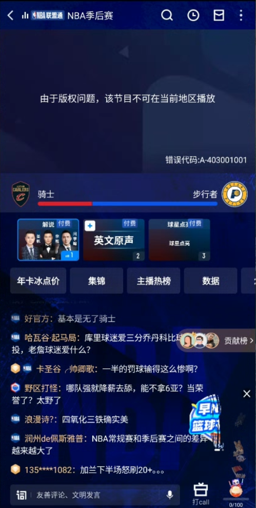

# 咪咕视频国外怎么看？地区限制解决方法与直播观看步骤

咪咕视频在国外提示地区限制、不能播放，常见原因是平台按网络位置限制节目的播放范围。先连接番茄回国加速器的影音回国线路，再退出并重开咪咕视频，进入原节目重新播放。

## 咪咕海外看不了，怎么连接番茄重新播放？

1. 打开[番茄回国加速器官网](https://www.fanqiejsq.com/)，下载手机或电脑对应版本，安装并登录。
2. 在当前客户端中选择影音、直播场景或适用的回国线路，完成连接。
3. 完全退出咪咕视频 App 后重新打开；电脑用户关闭原播放页再进入。
4. 搜索原来的赛事、电影或电视剧，进入具体场次或集数重新播放。

## 咪咕视频地区限制是什么原因？A-403001001 怎么处理？

这是节目对当前网络地区的播放限制，可以先连接番茄回国线路后重开节目。截图中的完整提示是“由于版权问题，该节目不可在当前地区播放”，下方显示 A-403001001；出现这个提示时，反复刷新原播放页通常不能改变连接地区。

## 手机咪咕视频地区限制怎么解决？

在实际播放的手机上连接番茄，再从后台完全退出咪咕视频并重开。不要只在电脑上连接后就直接用手机播放；换了 Wi-Fi 或移动网络后，也要查看番茄是否仍处于连接状态，再打开原节目。

### 国外用苹果手机看不了咪咕视频怎么办？

iPhone 用户按番茄官网的 iOS 下载入口安装，连接时按系统提示允许所需的网络配置。连接完成后重开咪咕视频即可尝试播放；如果之前另一个网络代理仍在运行，先退出它，避免多条连接相互影响。

## 电脑咪咕视频地域限制怎么解除？

在播放视频的电脑上安装并连接番茄，关闭原标签页后重新进入[咪咕视频官网](https://www.miguvideo.com/)。搜索节目名称进入播放页，先尝试原来的场次或集数；只刷新一直显示地区提示的旧标签页，可能仍沿用旧的播放状态。

## 在国外怎么看咪咕视频直播？

连接番茄后进入咪咕的目标赛事页，选择正在直播的场次。若只有预告或集锦，查看赛事页的开播时间和入口，注意页面时间与所在地时差；要看整场回放则选择完整回放。

直播已经能打开但反复缓冲时，换一条可用影音线路，并降低一档清晰度。

## 为什么在国外咪咕视频有的看不了？

不同节目、集数和赛事的播放范围可能不同，因此能看某一部剧，不代表所有内容都能直接播放。提示地区限制时按上面的连接方法处理；如果写的是会员、单独购买或内容已下架，就按该节目页面的具体要求处理。

## 在国外看咪咕视频收费吗？能免费看吗？

是否收费取决于具体节目，番茄回国线路不包含咪咕会员或赛事购买权益。免费内容与会员内容要分别看页面说明；需要付费的场次，连接番茄后仍需使用具备对应权益的咪咕账号。

## 连接后仍提示当前地区不可播放怎么办？

切换另一条可用影音回国线路，完全退出咪咕视频后重新进入同一节目。若仍出现相同提示，把节目链接、场次或集数以及报错截图发给番茄客服，便于针对该节目和线路处理。

## 相关视频

[海外看咪咕视频西甲直播遇到地区提示（YouTube）](https://www.youtube.com/watch?v=n9fXdUsAxxQ)

视频以海外观看西甲中文直播为例；当前赛事安排以咪咕对应赛事页为准。

本文由番茄回国加速器维护。更多操作见[连接检查清单](./connection-checklist.md)。

[返回影音与游戏指南](../README.md)
