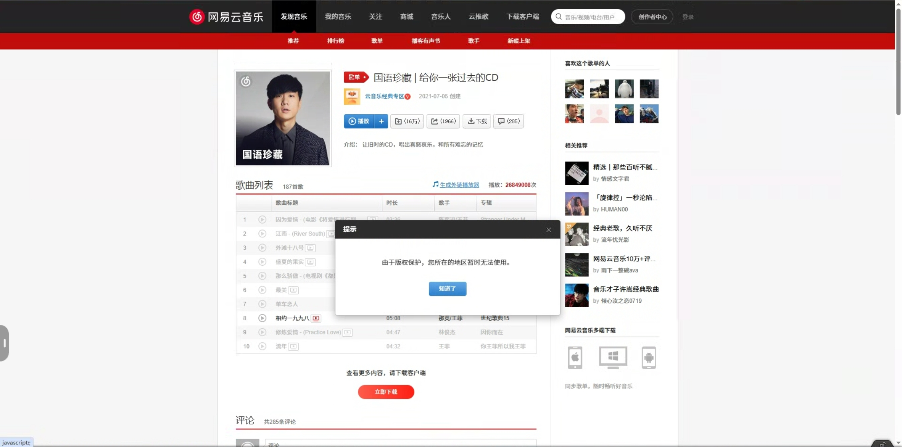

# 网易云地区限制怎么解决：海外听歌、灰色歌单与手机电脑操作

网易云音乐在海外提示所在地区无法使用，通常是当前网络位置不在歌曲的播放范围内。连接**番茄回国加速器的影音回国线路**，再重开网易云音乐，返回原歌单重新播放。

## 国外如何听网易云？按这四步连接

1. 从[番茄回国加速器官网](https://www.fanqiejsq.com/)下载适合手机或电脑的客户端，安装后登录。
2. 选择当前客户端提供的影音或音乐回国线路，等待连接完成。
3. 完全退出网易云音乐，再重新打开原歌单；网页用户关闭原歌曲页后重新打开。
4. 听歌时保持番茄连接。仍出现地区提示时，换一条可用线路，再重开网易云音乐。

## “由于版权保护，您所在的地区暂时无法使用”是什么意思？

这表示当前播放请求受到地区范围限制，可以先连接番茄回国线路后重试。它与登录失败不同，反复退出音乐账号通常不能解决网络位置导致的地区提示。

截图中的提示为“由于版权保护，您所在的地区暂时无法使用”。不同歌曲和专辑的可播放范围可能不同，出现这个提示时直接按前面的连接步骤处理。

## 手机网易云地区限制怎么解除？iOS和Android有区别吗？

两种手机都先在本机连接番茄，再彻底退出并重新打开网易云音乐。连接时按客户端提示完成系统网络授权，不需要通过改网易云昵称、个人资料所在地来替代回国线路。

切换Wi-Fi和移动网络后，若地区提示再次出现，回到番茄确认连接状态，再播放原曲。只在电脑上连接番茄，不会自动改变手机的连接。

## 国外电脑怎么听网易云？网页和客户端怎么用？

先在听歌的电脑上连接番茄，再打开网易云音乐客户端或[网易云音乐官网](https://music.163.com/)。网页已弹出地区提示时，关闭该歌曲页后重新打开，让新的播放请求使用当前连接。

客户端打不开但网页能正常打开时，可先用网页播放，并更新客户端；不要因为电脑端异常就删除手机上的歌单或下载文件。

## 歌单变灰、只有部分歌曲不能播放怎么办？

先连接番茄播放原曲；剩下少数灰色歌曲，可搜索同一歌名和歌手，选择当前可播放的版本。灰色状态还可能来自歌曲下架、版本变化或付费要求，具体看歌曲页的说明。

搜索时对照歌手、专辑和录音版本，尤其区分原唱、翻唱、现场版与伴奏。重新收藏可用版本即可，不必删除整张歌单。

## 出国后怎么听原来的收藏歌单？

使用原来的网易云账号登录，找到收藏歌单，再保持番茄连接播放受限歌曲。歌单列表不见了时，检查登录方式和账号是否一致；先找回原账号，避免新建歌单造成重复。

换一台设备后，也应在新设备上连接番茄。网络连接与账号收藏是两件事，不能只在旧手机连接后就直接让新电脑沿用。

## 网易云地区限制还是解除不了怎么办？

换一条番茄影音线路，然后完全退出网易云音乐再打开。若同一首歌仍显示相同地区提示，提供歌曲链接、截图和设备系统给番茄客服继续检查线路。

如果已经能播放，但听歌反复中断，暂停后台下载并降低音质；本地Wi-Fi信号弱时切换网络后重连。更多操作见[连接与排查清单](./connection-checklist.md)。

## 网易云海外听歌收费吗？能免费听吗？

能否免费听取决于具体歌曲的权益提示，身在海外不等于所有歌曲都要另付一笔费用。会员歌曲、数字专辑与免费内容分别按网易云当前页面处理；番茄套餐或试用查看番茄客户端，不能替代音乐会员。

## 下载好的歌曲为什么还是不能听？

先确认下载已经完成，再打开该歌曲查看是否有账号或权益提示。下载中断时保持番茄连接，检查剩余空间并重试失败项目；不要把“已添加到下载队列”当成已经可离线播放。

## 网易云音乐在国外打不开怎么办？

先确认本地网络能打开普通网页，再重新连接番茄并重开网易云音乐。如果只有客户端启动失败，可更新客户端或临时使用官网；如果弹出的是地区报错，则按本文的换线步骤处理。

## 视频参考

[出国后歌单变灰：网易云音乐与 QQ 音乐使用参考（YouTube）](https://www.youtube.com/watch?v=7seLzFzhKmo)

视频涉及网易云音乐和QQ音乐的海外使用场景，可配合本文操作参考。

本文由番茄回国加速器维护。[返回影音与游戏指南](../README.md)
