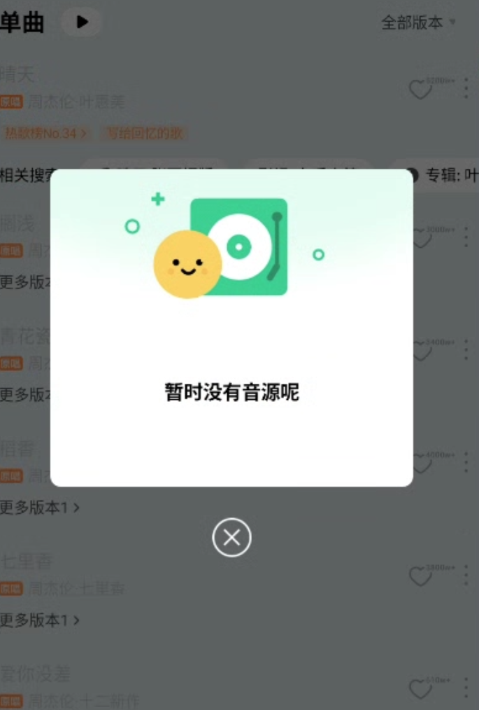

# 国外怎么听QQ音乐：播放、会员与歌曲下载排查

在国外使用QQ音乐，先打开想听的**具体歌曲**，确认当前账号、播放提示和下载提示。一直加载、要求购买、提示所在地区不可用，需要分别处理。番茄回国加速器可用于网络连接排查；QQ音乐中的收听、音质和下载权限仍以歌曲页面与账号权益为准。

## 报错截图示例

截图的实际文字是“暂时没有音源呢”，并没有明确写明地区限制。因此应先核对歌曲版本、音源与平台说明，再判断是否需要网络排查；不能把所有灰色歌曲或无音源提示都解释成海外网络问题。

此图用于识别报错；图中节目、活动和界面可能与当前不同，也不代表处理后已经恢复播放。

## 先确认是哪些歌曲不能听

从[QQ音乐官网](https://y.qq.com/)进入平台，使用原来收藏歌单的账号登录。记录歌名、歌手、专辑和报错文字，再选一首当前账号可以播放的歌曲作对照。不要只截歌单里一个灰色图标，具体播放页通常能提供更多线索。

| 你遇到的现象 | 接下来检查什么 |
| --- | --- |
| 首页和歌曲都长时间加载 | 同一设备的网络，以及换网后的加载情况 |
| 多数歌曲正常，只有某首失败 | 该歌曲版本、页面提示和购买状态 |
| 播放正常，点击下载才失败 | 下载权限、所选音质、存储空间和下载提示 |
| 歌单或会员突然不见了 | 当前账号是否与原来的登录账号一致 |

QQ音乐官方应用介绍提供按歌手、专辑等方式搜索的功能说明。用这些信息找到同一音源再比较，能避免把翻唱、现场版和录音室版混在一起。[查看开发者发布的应用说明](https://apps.apple.com/cn/app/qq音乐-听我想听/id414603431)。

## 页面转圈、歌曲断续时怎么操作

1. 先保持同一首歌和同一音质，暂停后台下载，记录未加速时能否开始播放、是否中途停顿。
2. 从[番茄回国加速器官网](https://www.fanqiejsq.com/)下载对应设备客户端，安装并登录，按客户端当前提供的影音场景或线路建立连接。
3. 完全退出QQ音乐后重新打开，仍播放刚才那一首歌。观察首次出声是否更顺畅、连续播放是否稳定，具体操作见[连接与排查清单](./connection-checklist.md)。
4. 如果没有改善，再分别尝试客户端其他可用线路或另一种本地网络。一次只改变一个条件，保留对照结果。

如果歌曲明确提示购买或版权地区限制，应转到歌曲权益与平台服务范围核查。连接成功只表示加速器建立了连接，不能证明某首歌一定可听。

## QQ音乐会员在国外能用吗？下载为什么还失败？

先查看账号实际显示的会员状态，再看目标歌曲要求；不要仅凭“已经有会员”推断全部内容和所有音质都可用。如果页面要求单曲或专辑购买，先核对是否已经用同一账号购买，以及页面说明的适用范围。

遇到QQ音乐下载版权限制，先分别尝试该歌曲的在线播放与下载，记录两种结果。若播放正常、下载失败，重点检查下载提示、设备可用空间、所选音质及对应权益。若已下载歌曲离线也无法播放，保留文件，回到应用核对账号和权限提示，避免先清空下载后失去排查线索。

需要反馈时，提供歌曲链接、国家或地区、设备系统、应用版本及完整提示截图；付费或内容权限问题交由QQ音乐核查，连接问题可通过番茄官网的客服入口反馈。截图请遮住账号、手机号和订单中的个人信息。

## 相关视频

[出国后歌单变灰：网易云音乐与 QQ 音乐使用参考（YouTube）](https://www.youtube.com/watch?v=7seLzFzhKmo)

视频主题包含 QQ 音乐和网易云音乐的海外歌单问题。排查 QQ 音乐时，仍需记录具体歌曲版本、播放提示及当前账号权益。

[返回影音与游戏指南](../README.md)
