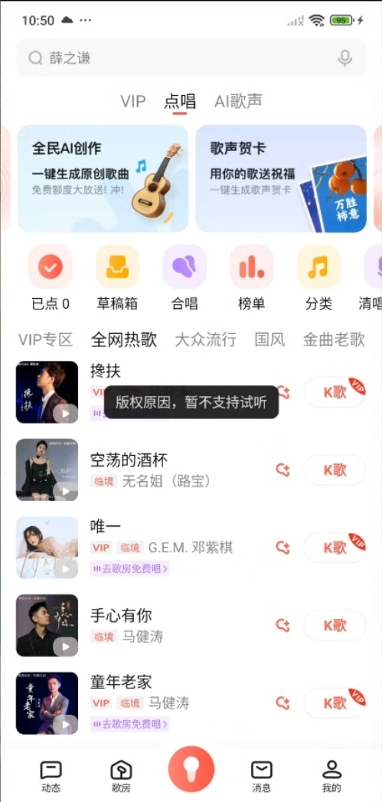

# 国外怎么用全民k歌？地区限制解决方法与使用问答

全民K歌出现地区限制，说明当前地区不能直接使用这首歌的相关功能。连接**番茄回国加速器**的影音回国线路，重新打开全民K歌，再试听歌曲或加载伴奏。

## 在国外怎么用全民K歌？

先连接番茄，再打开全民K歌，听歌和录唱期间保持连接。

1. 从[番茄下载中心](https://www.fanqiejsq.com/download/?utm_source=github&utm_medium=referral&utm_campaign=nine-platform-guides&utm_content=quanmin-kge)安装 iPhone 或 Android 对应版本，打开并登录。
2. 选择客户端当前提供的影音回国线路，等待连接成功。
3. 完全退出全民K歌后重新打开，进入想听或想唱的歌曲页面。
4. 重新试听、加载伴奏或打开作品；仍有地区提示时，换一条可用线路，再重开全民K歌。

## 全民K歌国外版权限制与地区限制是一回事吗？

不一定。明确写“所在地区不支持”的，是地区使用限制；只有“版权原因”的提示，还要看限制的是试听、伴奏还是其他功能。

图中原文是“版权原因，暂不支持试听”，没有写地区限制。连接番茄后，若只有这首歌仍无法试听，可以搜索同一首歌的其他版本，或查看该版本是否提供伴奏；不必因此重装整个 App。

## 全民K歌在 iOS 上遇到地区限制怎么处理？

iPhone 用户先在番茄的 iOS 客户端完成连接，再退出并重开全民K歌。连接后直接进入原来的歌曲或作品，而不是停留在旧播放页反复点击；仍受限时切换一条可用线路，重开后重试。

如果是录唱没有人声，还需检查麦克风权限，这与试听的地区提示是两类问题。iPhone 可按[Apple 官方说明](https://support.apple.com/zh-cn/guide/iphone/-iph168c4bbd5/ios)在设置中为全民K歌开启麦克风权限。

## 全民K歌在国外唱歌没有原音怎么办？

先分清没有的是歌手原唱、伴奏，还是自己的录音人声，三者的处理不同。

- **歌手原唱没有声音**：查看这个歌曲版本是否提供原唱及相应开关，必要时换一个版本。
- **伴奏加载不出来**：保持番茄连接，重新进入歌曲；多首伴奏都失败时换线再试。
- **伴奏有声、自己录不到**：检查麦克风权限、耳机输入与音量，录一小段再回听。

## 全民K歌在国外打不开怎么办？

如果 App 能打开，但首页或作品加载不出来，先连接番茄并重开 App；还不正常时换线路或本地网络。如果连界面都无法启动、持续闪退，优先更新并重启全民K歌，确认手机剩余空间。

重装前先保留未发布的录音和草稿。只有某首歌不能播放时，按歌曲版本及上面的版权提示处理，不需要反复卸载。

## 遇到版权限制，还能使用伴奏录唱吗？

要看该歌曲的伴奏入口是否可用，不能只凭试听报错判断。连接番茄后打开对应歌曲，尝试载入伴奏并录一小段；如果伴奏页面仍明确不可用，换官方提供的其他版本或歌曲。番茄回国连接不附送平台会员或付费歌曲权益。

## 海外如何看全民K歌作品、听歌房？

连接番茄后打开具体作品、分享链接或歌房，再播放内容。作品正常而歌房听不到声音时，先检查房间内是否有人正在演唱、自己的音量和静音状态；自己上麦却没有人声，则检查上麦状态和麦克风权限。

若作品和歌房都加载慢，换一条影音线路再重进；不要在正在录制或演唱时反复断开连接。

## 连接后仍有地区提示怎么办？

先重开全民K歌并换一条可用线路，再试原来的同一首歌。仍未恢复时，将歌曲或作品链接、完整提示和手机系统发给[番茄客服](https://www.fanqiejsq.com/?utm_source=github&utm_medium=referral&utm_campaign=nine-platform-guides&utm_content=quanmin-kge)，说明所在地区即可；公开截图时遮住个人信息。

## 视频参考

[海外想唱全民K歌却遇到地区提示：使用场景参考](https://www.youtube.com/watch?v=KxIV_nbKuXk)

本文由番茄回国加速器维护。更多操作见[连接使用步骤](./connection-checklist.md)。[返回全部专题](../README.md)
