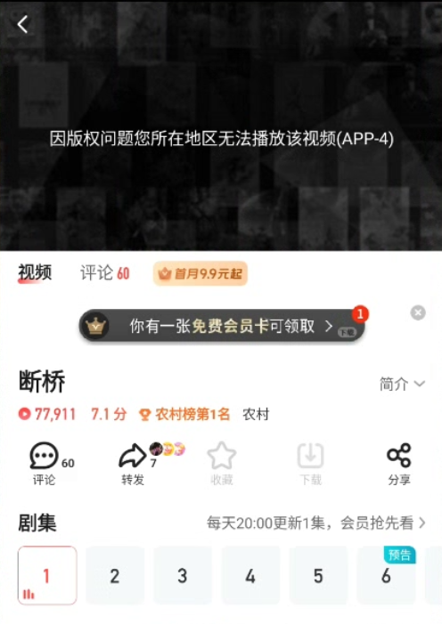

# 国外如何看搜狐视频？APP-4地区限制与播放问题解决方法

在国外看搜狐视频遇到 APP-4、“所在地区无法播放”，通常与当前网络位置和影片的播放地区范围有关；一直转圈、频繁缓冲，则可能与跨境网络不稳定有关。可以使用番茄回国加速器连接影音回国线路，再重开搜狐视频播放原来的剧集。

## 国外怎么看搜狐视频：连接番茄后重试

1. 打开[番茄回国加速器官网](https://www.fanqiejsq.com/?utm_source=github&utm_medium=referral&utm_campaign=platform-guides&utm_content=sohu-video)，下载对应系统的版本，安装并登录。手机选择 Android 或 iOS 版本，电脑选择 Windows 或 macOS 版本。
2. 选择客户端当前提供的影音场景或适用回国线路，完成连接。
3. 完全退出搜狐视频 App 后重新打开；电脑网页用户关闭原播放页，再进入[搜狐视频官网](https://tv.sohu.com/)。
4. 搜索原来的片名，进入要看的具体一集重新播放。若仍提示地区限制，可以换一条可用影音线路，再重启搜狐视频。

## APP-4 报错是什么原因？

截图中的原文是“因版权问题您所在地区无法播放该视频(APP-4)”。这是该视频的地区播放提示。海外遇到这类问题，可先通过番茄的回国线路处理网络位置相关限制；连接后重新打开具体一集，避免旧页面继续使用原连接。

## 仍然播放不好怎么办？

- **一直转圈或画面卡顿：**切换另一条可用影音线路，暂停大文件下载，再降低一档清晰度。
- **旧链接失效、集数不对：**回到剧集主页重新选择正片和集数，不要一直刷新旧播放页。
- **仍然显示 APP-4：**把节目链接、集数和报错截图发给番茄客服排查。
- **提示会员或单独购买：**按该影片要求登录对应账号，番茄回国线路不包含搜狐视频会员。

## 相关追剧场景视频

[海外看国产剧遇到地区提示的相关视频（YouTube）](https://www.youtube.com/watch?v=ioDO_N5ecsk)

这条视频介绍海外追国产剧的相关场景，供参考，未核实为搜狐视频专属操作教程。

本文由番茄回国加速器维护。更多操作见[连接检查清单](./connection-checklist.md)。

[返回影音与游戏指南](../README.md)
