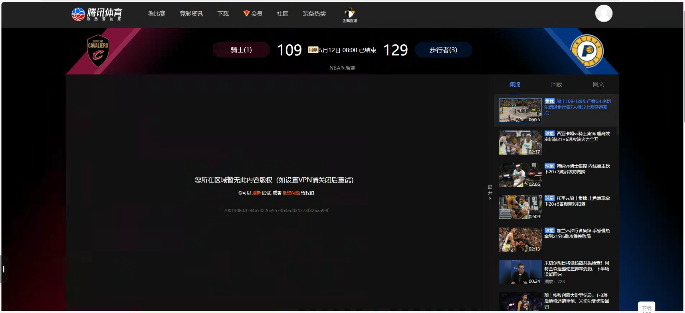

# 国外怎么看腾讯体育？地区限制解决方法与直播回放问答

腾讯体育提示“所在地区无法播放”，说明当前访问地区不在该视频的播放范围内。连接**番茄回国加速器**的影音回国线路，重新打开腾讯体育再播放。

## 国外怎么看腾讯体育直播？

先连接番茄回国线路，再进入腾讯体育的比赛直播页。操作顺序如下：

1. 从[番茄官方下载页](https://www.fanqiejsq.com/download/?utm_source=github&utm_medium=referral&utm_campaign=nine-platform-guides&utm_content=tencent-sports)安装手机或电脑对应版本，打开并登录。
2. 选择客户端当前提供的影音或直播场景，连接回国线路。
3. 连接成功后，完全退出腾讯体育 App 再重开；电脑用户重新打开[腾讯体育网页](https://sports.qq.com/)。
4. 搜索比赛或对阵双方，进入直播页面播放，观看期间保持番茄连接。

手机和电脑应分别在正在播放的设备上连接；只在手机开启番茄，不代表电脑的浏览器也使用了这条线路。

## 腾讯体育地区限制、海外版权限制是什么原因？

这类提示是具体视频的地区播放要求，与访问位置有关。同一赛事的直播、完整回放和集锦可能有不同播放范围，因此一条集锦能看，不代表所有比赛内容都能直接打开。

图中历史比赛页面提示“您所在区域暂无此内容版权（如设置VPN请关闭后重试）”。如果当前页面也明确要求关闭 VPN，按提示关闭当前连接再重试；持续出现相同提示时，将比赛链接和截图发给番茄客服检查线路。

## 海外怎么看腾讯体育的比赛回放？

连接番茄后，在对应赛事页选择完整回放，再打开要看的场次或单节录像。不要把几分钟的精彩集锦当成整场比赛；尚未显示完整回放时，查看赛事页的更新安排。旧收藏链接失效，可从比赛主页重新进入。

回放出现地区提示时，保持番茄连接，关闭原播放页后重新打开该条录像；只刷新首页不会重新载入已经打开的播放器。

## 美国怎么看腾讯体育，比赛时间怎么换算？

连接和播放步骤与上面相同，另外要看清开赛时间采用哪个时区。美国不同地区的当地时间不同，跨日时当地日期也可能与北京时间不一致，不要只按“今天”或“明天”找比赛。

如果页面显示比赛已结束，直接查找对应回放；若尚未开赛，等待直播开始即可，无需反复换线路。

## 腾讯体育在国外看不了怎么办？

已经连接番茄但仍无法播放，先按当前表现处理：

- **仍有地区提示：**切换一条可用影音线路，完全重开腾讯体育后进入原比赛页。
- **只有 App 不正常：**更新并重启 App，也可用同一账号尝试网页入口。
- **一直转圈或直播中断：**暂停后台下载，切换线路；仍缓冲时降低一档清晰度。
- **提示登录或购买：**登录原来购买比赛权益的账号，确认当前场次所需的会员或单场权益。

换线应在暂停播放后进行；连接完成再重开播放器，避免旧页面继续沿用原连接。

## 有腾讯会员，为什么还提示购买比赛？

以该场比赛页面列出的权益为准，不能仅凭账号有其他腾讯服务会员就判断比赛已经包含。番茄负责回国连接，不附送腾讯体育会员。已有订单仍未生效时，核对登录账号，并通过腾讯体育的订单帮助处理。

## 仍无法播放，怎样获得帮助？

把比赛链接、完整报错和使用设备发给[番茄客服](https://www.fanqiejsq.com/)，同时说明所在国家及刚才使用的线路，便于客服定位具体比赛与线路问题；公开截图时遮住账号信息。

## 相关视频

[海外看腾讯体育遇到地区限制的相关视频](https://www.youtube.com/watch?v=qfjbhKJgVqM)（历史视频，界面与活动以当前版本为准）。

本文由番茄回国加速器维护。更多操作见[回国加速器使用步骤](connection-checklist.md)。[返回全部专题](../README.md)
