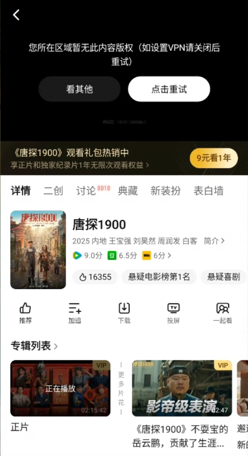

# 腾讯视频地区限制怎么办？海外看剧的解决方法

海外看腾讯视频出现地区限制，通常与平台识别到的网络位置及内容的地区范围有关；一直加载、频繁缓冲，则常与跨境连接不稳定有关。可以使用番茄回国加速器连接国内影音线路，再重新打开腾讯视频播放。

## 为什么会提示所在区域暂无版权？

腾讯视频会根据内容的地区范围提供播放服务。人在海外，即使能打开首页，也可能在电影、电视剧或动漫正片中遇到腾讯视频海外限制。

截图提示“您所在区域暂无此内容版权（如设置VPN请关闭后重试）”。已有其他 VPN 连接时，可先按提示关闭，避免同时使用多个网络代理。

## 用番茄回国加速器怎么操作？

1. 打开[番茄回国加速器官网](https://www.fanqiejsq.com/)，按设备下载并安装 Windows、macOS、iOS 或 Android 客户端。
2. 登录后选择适合影音的回国线路并连接，等待客户端显示连接成功。
3. 完全退出腾讯视频 App 后重新打开；电脑网页端重新打开播放页。
4. 进入想看的电影或剧集，选择具体集数播放，观看时保持番茄连接。

涉及腾讯视频会员或单独付费的内容，仍需对应账号权益。

## 连接后仍不能播放怎么办？

- **仍显示地区提示：** 更换一条可用的影音线路，重启腾讯视频再试。
- **能播放但卡顿：** 暂停下载、降低一档清晰度；Wi-Fi 不稳定时换本地网络。
- **只有某一集失败：** 从[腾讯视频官网](https://v.qq.com/)重新进入该集，避免使用失效的旧链接。

仍未改善，可将所在国家、设备型号和报错截图发给番茄客服协助检查线路；账号或订单问题可联系[腾讯视频客服](https://kf.qq.com/product/QQlive.html)。

## 相关视频

[海外看腾讯视频动漫遇到地区提示（YouTube）](https://www.youtube.com/watch?v=MKnxStVBRZ0)

视频对应海外观看腾讯视频动漫的场景，可配合上面的连接步骤参考。

本文由番茄回国加速器维护。[返回影音与游戏指南](../README.md)