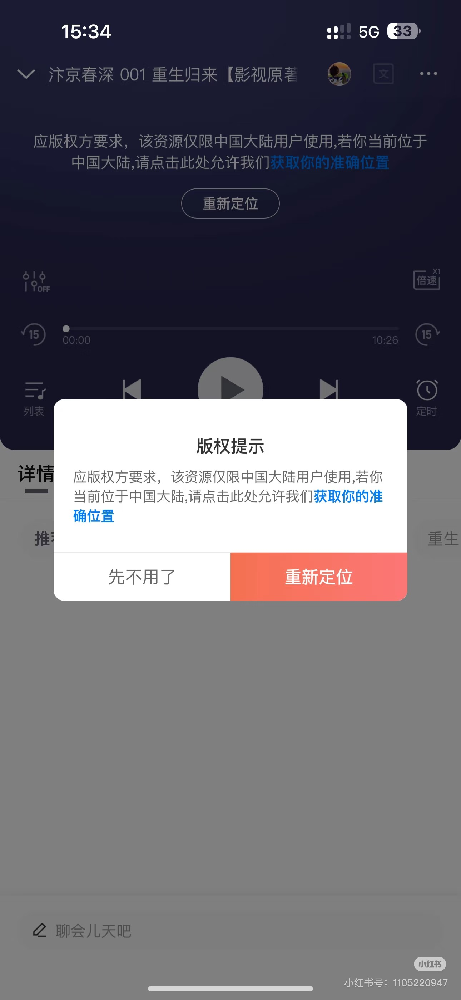

# 喜马拉雅地区限制怎么办：海外听书与播放卡顿解决方法

在国外听喜马拉雅时出现“仅限中国大陆用户使用”，原因是目标声音设置了播放地区范围；声音一直加载或断断续续，还可能与跨境网络连接有关。可以先连接**番茄回国加速器的影音回国线路**，再重新打开喜马拉雅，播放原来的专辑或单集。

## 用番茄连接后再听书

1. 打开[番茄回国加速器官网](https://www.fanqiejsq.com/)，下载安装适合手机或电脑的客户端。
2. 登录后选择当前可用的影音回国线路，等待连接完成。
3. 完全退出喜马拉雅再打开，进入想听的专辑，重新播放出现提示的那一集。
4. 听书时保持连接。如果仍提示地区限制或持续缓冲，切换一条可用线路，再重开喜马拉雅重试。

## 喜马拉雅版权限制会显示什么？

图中提示“该资源仅限中国大陆用户使用”；其中“重新定位”的说明面向当前位于中国大陆的用户，海外用户可先按上面的回国线路步骤处理。

## 连接后仍然不能听怎么办？

- **只有某一集不能听：**重新进入专辑目录，试播其他单集；也可在[喜马拉雅](https://www.ximalaya.com/)搜索同名书籍的其他演播版本。
- **多张专辑都卡顿：**暂停后台下载，切换 Wi-Fi 或移动网络，再重新连接番茄。
- **缓存没有声音：**检查该集是否下载完成，先试在线播放，不要急着删除整张专辑的缓存。

番茄不替代喜马拉雅会员或单独付费专辑购买；[官方会员说明](https://www.ximalaya.com/gatekeeper/member-agreement-html/ts-1626084264680)可查看具体付费范围。

换线路后仍有问题，可提供专辑、单集链接和报错截图联系番茄客服；连接操作也可查看[连接与排查清单](./connection-checklist.md)。

## 视频参考

[海外使用喜马拉雅听书参考（YouTube）](https://www.youtube.com/watch?v=Q74v8PDNnKE)

视频围绕海外听书场景展开，可配合本文的连接方法参考。

本文由番茄回国加速器维护。 [返回影音与游戏指南](../README.md)
