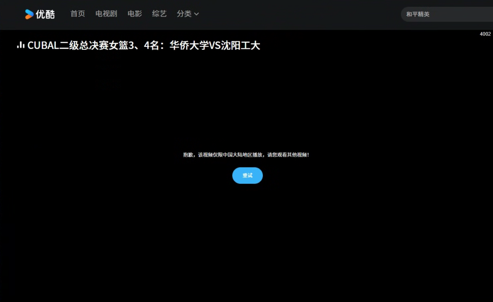

# 优酷地区限制怎么办？国外播放与卡顿解决方法

国外看优酷提示“仅限中国大陆地区播放”，通常与平台识别到的网络位置和内容地区范围有关。可以使用番茄回国加速器连接国内影音线路，再重新打开优酷；如果是加载慢或反复缓冲，也可通过回国线路改善跨境连接。

## 优酷国外版权受限是什么原因？

有些视频只在特定地区提供播放，海外网络访问时便可能出现地区提示。这类提示和单纯网速慢不同，因此只降低画质往往不能解决地区提示。

截图显示“抱歉，该视频仅限中国大陆地区播放，请您观看其他视频！”，右上角有错误码 4002。

## 用番茄回国加速器连接优酷

1. 进入[番茄回国加速器官网](https://www.fanqiejsq.com/)，下载对应的 Windows、macOS、iOS 或 Android 客户端。
2. 安装登录后，选择国内影音线路并完成连接。
3. 手机端完全退出优酷后重开；电脑端重新打开[优酷官网](https://www.youku.com/)上的播放页。
4. 搜索想看的节目，进入具体集数播放，观看时保持番茄连接。

需要优酷会员或单独付费的节目，仍需相应账号权益。

## 连接后还有问题怎么办？

- **依然提示地区限制：** 更换可用影音线路，再重启优酷。
- **能看但缓冲多：** 暂停后台下载、降低清晰度；本地网络不稳定时切换 Wi-Fi 或移动网络。
- **网页黑屏，App 正常：** 更新浏览器，或先使用客户端观看。
- **手机能看，投屏失败：** 先在手机上播放，另外检查电视端的网络和投屏提示。

若仍未恢复，向番茄客服提供设备和报错截图检查线路；客户端或投屏问题也可查[优酷帮助中心](https://csc.youku.com/feedback-web/help/index.html?style=1)。

## 相关视频

[国外看优酷出现大陆限制提示（2025 年视频，YouTube）](https://www.youtube.com/watch?v=amKsJ67a8jw)

视频可参考连接方法，其中旧活动和费用以当前产品页面为准。

本文由番茄回国加速器维护。[返回影音与游戏指南](../README.md)